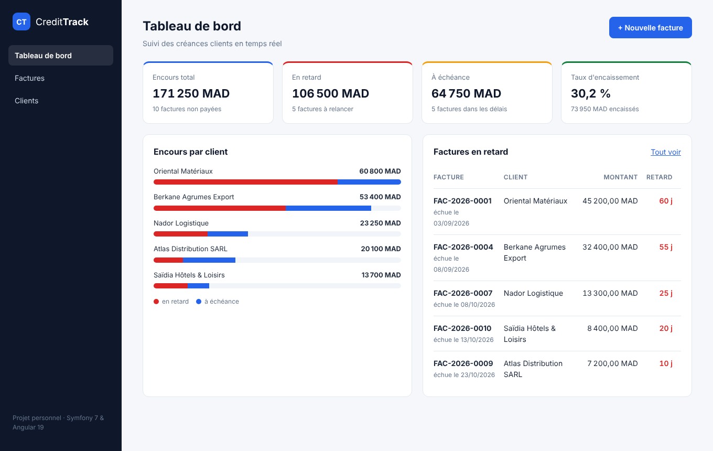
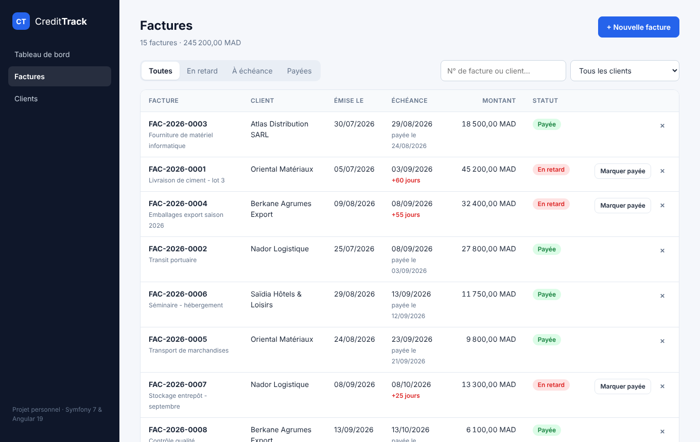
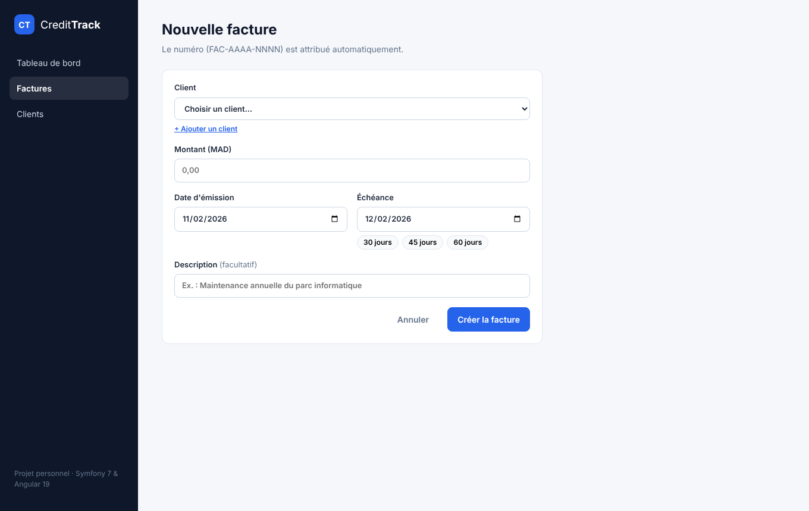

# 💳 CreditTrack – Suivi des factures et des créances clients

> Application web full-stack qui aide une PME à savoir **qui lui doit de l'argent, combien, et depuis quand** : factures, échéances, paiements et tableau de bord des retards.




## ✨ Fonctionnalités

- **Clients** : création et liste des clients (raison sociale, e-mail, téléphone).
- **Factures** : création avec numérotation automatique (`FAC-2026-0001`), montant, date d'émission et échéance (raccourcis 30 / 45 / 60 jours).
- **Statut calculé automatiquement** à partir des dates : *payée*, *à échéance* ou *en retard*, avec le nombre de jours de retard.
- **Liste filtrable** : par statut, par client et par recherche (numéro ou nom du client).
- **Enregistrement des paiements** en un clic.
- **Tableau de bord** : encours total, montant en retard, taux d'encaissement, encours par client et factures à relancer.
- **Validation des données** côté Angular (formulaires réactifs) et côté API (erreurs 422 par champ).

| Liste des factures | Nouvelle facture |
|---|---|
|  |  |

## 🛠️ Stack technique

| Couche | Technologies |
|---|---|
| Backend | PHP 8.3, **Symfony 7.4 (LTS)**, Doctrine ORM 3, Doctrine Migrations |
| Base de données | **PostgreSQL 16** |
| Frontend | **Angular 19** (composants standalone, signals, formulaires réactifs), TypeScript, SCSS |
| Tests | PHPUnit (règles métier), Jasmine / Karma (service HTTP, validateurs) |
| DevOps | **Docker**, Docker Compose, Nginx, **GitHub Actions** (CI) |

## 🏗️ Architecture

```
Navigateur ──► Nginx (conteneur frontend, port 8080)
                 ├── /        → application Angular compilée
                 └── /api/*   → API REST Symfony (conteneur backend, port 8000)
                                   └── Doctrine ORM ──► PostgreSQL (conteneur db)
```

Choix de conception :
- **Le statut d'une facture n'est jamais stocké** : il est déduit de `paid_at` et `due_date`. Il ne peut donc pas devenir incohérent (une facture devient « en retard » le lendemain de son échéance sans traitement planifié). La même règle est appliquée en PHP (`Invoice::getStatus()`) et en SQL pour les filtres (`InvoiceRepository::applyStatus()`).
- **Montants en `NUMERIC(12,2)`** et non en flottants, pour éviter les erreurs d'arrondi.
- **Index `(paid_at, due_date)`** pour accélérer les filtres par statut.
- En Docker, Nginx sert l'application et redirige `/api` vers Symfony : le navigateur ne voit qu'une seule origine.

## 🚀 Lancer le projet

### Avec Docker (recommandé)

```bash
git clone https://github.com/mohammed-mrabet/credittrack.git
cd credittrack
docker compose up --build
```

- Application : http://localhost:8080
- API : http://localhost:8000/api/health

Au premier démarrage, les migrations sont exécutées et un jeu de données de démonstration est chargé (5 clients, 15 factures).

### Sans Docker

Prérequis : PHP 8.2+, Composer, Node.js 20+, PostgreSQL.

```bash
# Backend
cd backend
composer install
# Adapter DATABASE_URL dans un fichier .env.local si besoin
php bin/console doctrine:database:create
php bin/console doctrine:migrations:migrate
php bin/console app:seed
php -S 127.0.0.1:8000 -t public

# Frontend (autre terminal)
cd frontend
npm install
npm start          # http://localhost:4200, /api redirigé vers le port 8000
```

### Tests

```bash
cd backend && vendor/bin/phpunit
cd frontend && npm test
```

## 📡 API REST

| Méthode | Route | Description |
|---|---|---|
| GET | `/api/dashboard` | Indicateurs du tableau de bord |
| GET | `/api/invoices?status=overdue&clientId=2&q=FAC` | Liste filtrée (`status` : `paid`, `unpaid`, `overdue`) |
| GET | `/api/invoices/{id}` | Détail d'une facture |
| POST | `/api/invoices` | Création : `{ clientId, amount, issueDate, dueDate, description }` |
| POST | `/api/invoices/{id}/pay` | Enregistre le paiement (`{ paidAt }` facultatif) |
| DELETE | `/api/invoices/{id}` | Suppression |
| GET / POST | `/api/clients` | Liste / création des clients |
| GET | `/api/health` | Vérification de l'état du service |

## 🔄 Intégration continue

À chaque `push`, GitHub Actions :
1. installe le backend, lance les **tests PHPUnit**, exécute les **migrations** sur un PostgreSQL de test, valide le schéma Doctrine et appelle l'API ;
2. lance les **tests Angular** en navigateur headless puis le **build de production** ;
3. construit les **images Docker**, démarre la stack complète et vérifie qu'elle répond.

## 🗺️ Pistes d'amélioration

- Authentification JWT et gestion de plusieurs utilisateurs
- Relances automatiques par e-mail (Symfony Messenger + tâche planifiée)
- Export PDF des factures
- Passage à Nginx + PHP-FPM et déploiement sur un hébergeur cloud

## 👤 Auteur

**Mohammed MRABET** – Master Ingénierie Informatique, Faculté des Sciences d'Oujda
[LinkedIn](https://www.linkedin.com/in/mohammed-mrabet-b3021b410/) · [GitHub](https://github.com/mohammed-mrabet)
